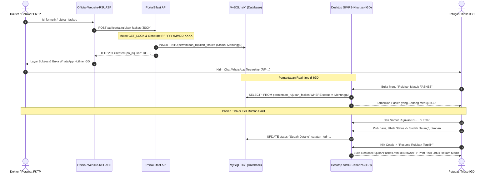

# Modul 06: Fitur Pemantauan Permintaan Rujukan Masuk FASKES (IGD)

Dokumen ini merupakan panduan teknis, arsitektur antarmuka, dan operasional resmi untuk **Modul Pemantauan Permintaan Rujukan Masuk FASKES** pada aplikasi desktop **SIMRS-Khanza** (Java Swing).

---

## 1. Latar Belakang & Peran Modul di Unit Gawat Darurat (IGD)

Selama ini, rujukan pasien gawat darurat dari Fasilitas Kesehatan Tingkat Pertama (FKTP / Puskesmas / Klinik / Praktik Dokter Mandiri) seringkali hanya diinfokan melalui telepon atau pesan WhatsApp non-formal. Hal ini menyebabkan:
1. Dokter dan perawat IGD tidak memiliki catatan rekam medis awal sebelum pasien tiba (*pre-hospital notification*).
2. Kesiapan fasilitas kritis (seperti bed resusitasi, ventilator, oksigen lanjutan, atau inkubator) terlambat disiapkan.
3. Riwayat rujukan tidak terdokumentasi secara terpusat di database rumah sakit.

### Solusi Modul di SIMRS-Khanza:
Modul **Rujukan Masuk FASKES** menyediakan antarmuka desktop native bagi petugas IGD untuk:
- Memantau kedatangan pasien rujukan secara **real-time** yang telah diinputkan oleh perujuk melalui website resmi rumah sakit.
- Melihat ringkasan klinis terurai: diagnosa kerja, keluhan utama, tanda-tanda vital lengkap, terapi pra-rumah sakit yang sudah diberikan, serta kebutuhan fasilitas prioritas.
- Memperbarui status pasien (*Menunggu*, *Sudah Datang*, *Batal*) dan menambahkan catatan tindakan triase IGD.
- Mencetak **Lembar Resume Permintaan Rujukan Gawat Darurat** resmi berformat HTML siap cetak untuk arsip fisik berkas Rekam Medis (RM).

---

## 2. Struktur Database & Konfigurasi Tabel

Modul ini beroperasi langsung pada database utama SIMRS Khanza (`sik`).

### 2.1 Skrip DDL Database
Berkas SQL mandiri tersimpan pada:
`database/2026-11-04-create-permintaan-rujukan-faskes.sql`

```sql
CREATE TABLE IF NOT EXISTS `permintaan_rujukan_faskes` (
  `no_rujukan` varchar(20) NOT NULL COMMENT 'Format: RF-YYYYMMDD-XXXX',
  `tanggal_rujukan` date NOT NULL,
  `jam_rujukan` time NOT NULL,
  `nama_fktp` varchar(100) NOT NULL,
  `nama_perujuk` varchar(60) NOT NULL COMMENT 'Nama dokter/bidan/perawat FKTP',
  `no_telp_perujuk` varchar(20) NOT NULL COMMENT 'No WA/HP kontak perujuk',
  `nama_pasien` varchar(100) NOT NULL,
  `no_ktp` varchar(20) NOT NULL COMMENT 'NIK 16 digit',
  `jk` enum('L','P') NOT NULL,
  `tgl_lahir` date DEFAULT NULL,
  `umur` varchar(15) DEFAULT NULL COMMENT 'Contoh: 35 Th / 6 Bl',
  `no_telp_pasien` varchar(20) DEFAULT NULL,
  `diagnosa` text NOT NULL COMMENT 'Diagnosa kerja/awal perujuk',
  `keluhan_utama` text DEFAULT NULL COMMENT 'Keluhan & alasan rujukan',
  `tanda_vital_kesadaran` varchar(30) DEFAULT NULL COMMENT 'Compos Mentis / Apatis / Somnolen / Sopor / Koma',
  `tanda_vital_td` varchar(15) DEFAULT NULL COMMENT 'Tekanan Darah, misal: 120/80',
  `tanda_vital_nadi` varchar(10) DEFAULT NULL COMMENT 'x/menit',
  `tanda_vital_rr` varchar(10) DEFAULT NULL COMMENT 'x/menit',
  `tanda_vital_suhu` varchar(10) DEFAULT NULL COMMENT 'Derajat celcius',
  `tanda_vital_spo2` varchar(10) DEFAULT NULL COMMENT 'Saturasi O2 (%)',
  `tindakan_diberikan` text DEFAULT NULL COMMENT 'Terapi, oksigen, obat yang sudah diberi',
  `transportasi` varchar(50) DEFAULT NULL COMMENT 'Ambulans FKTP / Mobil Pribadi / dll',
  `kebutuhan_khusus` varchar(100) DEFAULT NULL COMMENT 'Resusitasi / Isolasi / Inkubator / Oksigen Lanjutan',
  `estimasi_tiba` varchar(50) DEFAULT NULL COMMENT 'Contoh: 15 menit / Pukul 17:30',
  `status` enum('Menunggu','Sudah Datang','Batal') NOT NULL DEFAULT 'Menunggu',
  `catatan_igd` text DEFAULT NULL COMMENT 'Catatan tindak lanjut petugas IGD',
  `ip_address` varchar(45) DEFAULT NULL,
  `user_agent` text DEFAULT NULL,
  `created_at` timestamp DEFAULT CURRENT_TIMESTAMP,
  `updated_at` timestamp DEFAULT CURRENT_TIMESTAMP ON UPDATE CURRENT_TIMESTAMP,
  PRIMARY KEY (`no_rujukan`),
  KEY `idx_tgl_status` (`tanggal_rujukan`, `status`),
  KEY `idx_no_ktp` (`no_ktp`),
  KEY `idx_nama_pasien` (`nama_pasien`)
) ENGINE=InnoDB DEFAULT CHARSET=latin1 COLLATE=latin1_swedish_ci;
```

---

## 3. Arsitektur Antarmuka Desktop (`DlgPermintaanRujukanFaskes.java`)

Berkas form visual terletak pada:
- `src/permintaan/DlgPermintaanRujukanFaskes.java`
- `src/permintaan/DlgPermintaanRujukanFaskes.form`

Mengikuti tata letak standar antarmuka SIMRS Khanza, komponen dibagi menjadi tiga area utama:

```
┌────────────────────────────────────────────────────────────────────────┐
│ [v] Input Data Rujukan & Pembaruan Status (PanelInput - Collapsible)   │
│ ┌────────────────────────────────────────────────────────────────────┐ │
│ │ No. Rujukan: [           ] Tgl: [        ] FKTP: [               ] │ │
│ │ Pasien: [NIK             ] [Nama         ] JK: [ ] Umur: [       ] │ │
│ │ Transportasi: [          ] Estimasi Tiba: [      ] Diagnosa: [...] │ │
│ │ Tanda Vital: [GCS, TD, HR, RR, Suhu, SpO2                        ] │ │
│ │ Keluhan: [               ] Terapi: [     ] Status: [Menunggu    v] │ │
│ │                                            Catatan: [            ] │ │
│ └────────────────────────────────────────────────────────────────────┘ │
├────────────────────────────────────────────────────────────────────────┤
│ Tabel Rujukan Masuk (tbRujukan - WarnaTable, 20 Kolom Model)           │
│ [No Rujukan] [Tgl/Jam] [FKTP] [Petugas] [Pasien] [NIK] [Diagnosa] ...  │
├────────────────────────────────────────────────────────────────────────┤
│ Panel Bawah (jPanel3 - Filter, Pencarian & Tombol Aksi)                │
│ Tanggal: [2026-11-04] s.d. [2026-11-04] Status: [Semua v] Keyword: [ ]│
│ [Baru] [Hapus] [Ganti Status] [Cetak] [Keluar]              Record: 12 │
└────────────────────────────────────────────────────────────────────────┘
```

### 3.1 Panel Atas: Input & Tampilan Rincian (`PanelInput`)
- Dilengkapi dengan *collapsible toggle* `ChkInput` (`isForm()`). Jika centang dibuka, panel berukuran tinggi 192px menampilkan rincian data lengkap; jika dicentang tutup, panel mengecil menjadi 20px sehingga area tabel menjadi sangat lega.
- Menampilkan rincian:
  - **Faskes & Kontak**: `TFaskes`, `TPetugas`, `TKontak`.
  - **Identitas Pasien**: `TNIK`, `TNmPasien`, `TJK`, `TUmur`, `TTelpPasien`.
  - **Kondisi Klinis**: `TDiagnosa`, `TTandaVital`, `TKeluhan` (textarea), `TTindakan` (textarea), `TKebutuhan`.
  - **Kontrol Status Inline**: Dropdown `cmbStatusUpdate` (*Menunggu*, *Sudah Datang*, *Batal*) dan textarea `txtCatatanIGD` (maksimal 1.000 karakter via `batasInput`).

### 3.2 Tabel Tengah: Grid Data Rujukan (`tbRujukan`)
- Menggunakan `DefaultTableModel` dengan 20 kolom data.
- **Kolom Terlihat (0 s.d. 14)**:
  1. `No. Rujukan` (130px)
  2. `Tanggal & Jam` (120px)
  3. `FKTP Perujuk` (150px)
  4. `Petugas Perujuk` (130px)
  5. `Kontak Perujuk` (100px)
  6. `Nama Pasien` (160px)
  7. `NIK / No. KTP` (120px)
  8. `JK` (35px)
  9. `Umur` (65px)
  10. `Diagnosa` (180px)
  11. `Tanda Vital` (220px — format terangkum: *GCS | TD | HR | RR | S | SpO2*)
  12. `Transportasi` (100px)
  13. `Estimasi Tiba` (90px)
  14. `Status` (85px)
  15. `Catatan IGD` (160px)
- **Kolom Tersembunyi (15 s.d. 19, lebar 0px)**:
  `Keluhan Utama`, `Tindakan Diberikan`, `Kebutuhan Khusus`, `No. Telp Pasien`, `Tgl. Lahir`.
  *Tujuan:* Menyimpan data sekunder di dalam memory model tabel tanpa memperlambat query saat baris diklik (`getData()`).
- Dihias dengan pewarnaan baris otomatis `WarnaTable()`.

### 3.3 Panel Bawah: Kontrol Filter & Tombol Aksi (`jPanel3`)
- **Filter Tanggal**: `DTPCari1` s.d. `DTPCari2` (default tanggal hari ini).
- **Filter Status**: `cmbStatus` (*Semua*, *Menunggu*, *Sudah Datang*, *Batal*).
- **Pencarian Cepat (`TCari`)**: Kotak input teks yang secara fleksibel mencari ke dalam 5 field sekaligus:
  - Nomor Rujukan (`no_rujukan`)
  - Nama Pasien (`nama_pasien`)
  - NIK (`no_ktp`)
  - Asal FKTP (`nama_fktp`)
  - Diagnosa Klinis (`diagnosa`)
- **Daftar Tombol**:
  - `BtnCari` (Mnemonic Alt+C): Menjalankan kueri filter berdasarkan tanggal, status, dan kata kunci `TCari`.
  - `BtnAll` (Mnemonic Alt+V): Mereset kata kunci pencarian dan status filter ke "Semua", lalu memuat ulang seluruh data.
  - `BtnBatal` (Mnemonic Alt+B): Mengosongkan isian form dan melepas seleksi tabel.
  - `BtnHapus` (Mnemonic Alt+H): Menghapus rujukan terpilih dengan kotak konfirmasi `JOptionPane.showConfirmDialog`.
  - `BtnGantiStatus`: Memperbarui status rujukan dan catatan IGD secara instan tanpa dialog modal terpisah.
  - `BtnPrint`: Menampilkan menu opsi cetak dokumen.
  - `BtnKeluar`: Menutup dialog form.

---

## 4. Logika Bisnis & Alur Operasional Petugas IGD

### 4.1 Pemuatan Data (`tampil()`)
Method `tampil()` menggunakan `PreparedStatement` berparameter untuk keamanan dari SQL Injection:
```java
String sql = "select no_rujukan, tanggal_rujukan, jam_rujukan, nama_fktp, nama_perujuk, no_telp_perujuk, "
        + "nama_pasien, no_ktp, jk, tgl_lahir, umur, no_telp_pasien, diagnosa, keluhan_utama, "
        + "tanda_vital_kesadaran, tanda_vital_td, tanda_vital_nadi, tanda_vital_rr, tanda_vital_suhu, tanda_vital_spo2, "
        + "tindakan_diberikan, transportasi, kebutuhan_khusus, estimasi_tiba, status, catatan_igd "
        + "from permintaan_rujukan_faskes where tanggal_rujukan between ? and ? ";

if (!cmbStatus.getSelectedItem().toString().equals("Semua")) {
    sql += "and status = ? ";
}
if (!TCari.getText().trim().equals("")) {
    sql += "and (no_rujukan like ? or nama_pasien like ? or no_ktp like ? or nama_fktp like ? or diagnosa like ?) ";
}
sql += "order by tanggal_rujukan desc, jam_rujukan desc";
```

### 4.2 Pembaruan Status & Catatan IGD (`BtnGantiStatusActionPerformed`)
Ketika pasien rujukan tiba di IGD rumah sakit:
1. Petugas mencari pasien berdasarkan Nomor Rujukan atau Nama di tabel.
2. Memilih status baru pada `cmbStatusUpdate`:
   - **`Sudah Datang`**: Pasien telah tiba di IGD dan memasuki tahap registrasi/triase.
   - **`Batal`**: Rujukan dibatalkan oleh pihak FKTP atau dialihkan ke fasilitas lain.
3. Mengetik catatan triase pada `txtCatatanIGD` (contoh: *"Tiba pukul 18:15 WIB via Ambulans Puskesmas, langsung masuk Bed Resusitasi 1"*).
4. Klik tombol **Ganti Status** (`BtnGantiStatus`).
5. Sistem mengeksekusi update SQL:
   ```sql
   UPDATE permintaan_rujukan_faskes SET status = ?, catatan_igd = ? WHERE no_rujukan = ?
   ```
6. Tabel me-refresh otomatis dan tetap mempertahankan fokus seleksi pada baris yang baru diperbarui.

---

## 5. Fitur Pelaporan & Pencetakan Berkas Medis (`BtnPrint`)

Saat tombol `BtnPrint` diklik, sistem menampilkan dialog opsi interaktif:

```java
Object[] options = {"Resume Rujukan Terpilih", "Daftar Semua Rujukan", "Batal"};
int choice = JOptionPane.showOptionDialog(rootPane,
        "Pilih jenis cetakan data rujukan:",
        "Cetak Dokumen Rujukan", ...);
```

### 5.1 Opsi 1: Resume Rujukan Terpilih (`cetakResume()`)
- Mencetak **Lembar Resume Permintaan Rujukan Gawat Darurat (FKTP)** untuk 1 pasien terpilih ke dalam format berkas HTML (`ResumeRujukanFaskes.html`).
- Berkas HTML otomatis dibuka di web browser bawaan sistem (`Desktop.getDesktop().browse(f.toURI())`).
- **Kandungan Berkas Resume**:
  - **Header Resmi Rumah Sakit**: Mengambil identitas nama RS (`akses.getnamars()`), alamat lengkap, nomor kontak, dan email dari konfigurasi sistem.
  - **Badge Status Berwarna**: Status *Menunggu* (kuning), *Sudah Datang* (hijau), *Batal* (merah).
  - **Seksi A: Informasi Rujukan & Fasilitas Perujuk**: No. Rujukan, Tanggal/Jam, Nama FKTP, Nama Dokter/Petugas, No Kontak.
  - **Seksi B: Identitas Pasien**: Nama Lengkap, NIK 16 digit, JK, Umur, Tanggal Lahir, No. Telp Pasien.
  - **Seksi C: Kondisi Klinis & Tanda Vital**: Diagnosa kerja, keluhan utama, rincian tanda vital lengkap (GCS, TD, Nadi, RR, Suhu, SpO2), dan terapi yang telah diberikan di faskes perujuk.
  - **Seksi D: Transportasi & Persiapan IGD**: Moda transportasi, estimasi tiba, kebutuhan khusus/alat prioritas, dan catatan petugas IGD.
  - **Kolom Tanda Tangan**: Kolom verifikasi Petugas Perujuk FKTP dan Petugas Triage IGD (mengambil nama user login via `akses.getnamauser()`).
- **Pemanfaatan Klinis**: Dapat langsung dicetak ke printer kertas fisik (Ctrl+P di browser) untuk dijadikan lampiran resmi berkas Rekam Medis (RM) fisik pasien IGD.

### 5.2 Opsi 2: Daftar Semua Rujukan (`cetakDaftar()`)
- Mencetak rekapitulasi seluruh baris data rujukan yang sedang tampil sesuai filter tanggal dan status aktif ke berkas `LaporanPermintaanRujukanFaskes.html`.
- Berguna untuk pelaporan berkala operasional IGD, evaluasi rujukan FKTP jejaring, dan audit pelayanan pra-rumah sakit.

---

## 6. Pendaftaran Menu & Hak Akses Pengguna

### 6.1 Pendaftaran di Menu Utama (`src/simrskhanza/frmUtama.java`)
1. **Deklarasi Komponen**:
   ```java
   private widget.ButtonBig btnPermintaanRujukanFaskes;
   ```
2. **Inisialisasi Ikon & Properti**:
   - Ikon tombol: `/48x48/1485357935_ambulance.png` (ikon ambulans Khanza).
   - Teks tombol: `"Rujukan Masuk FASKES"`.
   - Ukuran preferensi: `Dimension(200, 90)`.
3. **Pendaftaran ke Panel Menu**:
   ```java
   if (akses.getpermintaan_rujukan_faskes() == true) {
       Panelmenu.add(btnPermintaanRujukanFaskes);
       jmlmenu++;
   }
   ```
4. **Pencarian Menu Instan**:
   Tombol ini terdaftar dalam filter pencarian menu `TCari` di layar utama Khanza. Cukup ketik `"rujukan"` atau `"faskes"`, menu otomatis muncul.
5. **Event Handler Klik**:
   Membuka form secara *non-modal* dengan ukuran proporsional terhadap `PanelUtama` dan kursor wait.

### 6.2 Hak Akses Otorisasi (`src/fungsi/akses.java`)
- Variabel kontrol:
  ```java
  public static boolean permintaan_rujukan_faskes = false;
  ```
- Otorisasi Super Admin: Otomatis diset `true` untuk user `admin`.
- Otorisasi User Spesifik: Dibaca dari tabel user dengan penanganan exception aman:
  ```java
  try {
      akses.permintaan_rujukan_faskes = rs2.getBoolean("permintaan_rujukan_faskes");
  } catch (Exception e) {
      akses.permintaan_rujukan_faskes = false;
  }
  ```
  *Keunggulan:* Jika kolom `permintaan_rujukan_faskes` belum ditambahkan di tabel `user` pada instalasi rumah sakit tertentu, aplikasi tidak akan crash/error.
- Getter publik: `akses.getpermintaan_rujukan_faskes()`.

---

## 7. Keterkaitan Lintas Tiga Aplikasi



1. **Konsistensi Nomor Rujukan**:
   Nomor `RF-YYYYMMDD-XXXX` yang diterbitkan oleh PortalSifast menjadi nomor identifikasi tunggal di seluruh sistem:
   - Terbaca di pesan WhatsApp petugas perujuk.
   - Ditampilkan di layar web perujuk.
   - Menjadi kata kunci pencarian di kotak `TCari` desktop Khanza.
   - Dicetak sebagai nomor referensi pada lembar resume rekam medis HTML.
2. **Kemandirian Modul**:
   Modul desktop ini tidak bergantung pada layanan cloud eksternal apa pun saat beroperasi. Petugas IGD membaca langsung dari basis data internal rumah sakit (`sik`), memastikan operasional IGD tetap 100% berjalan lancar meski koneksi internet luar terganggu.
3. **Peluang Bridging Masa Depan**:
   Tabel `permintaan_rujukan_faskes` dirancang modular. Di masa mendatang, modul ini siap di-bridging langsung dengan penambahan tombol *"Registrasikan Pasien"* untuk mentransfer NIK dan identitas pasien secara otomatis ke tabel registrasi IGD (`reg_periksa`).
